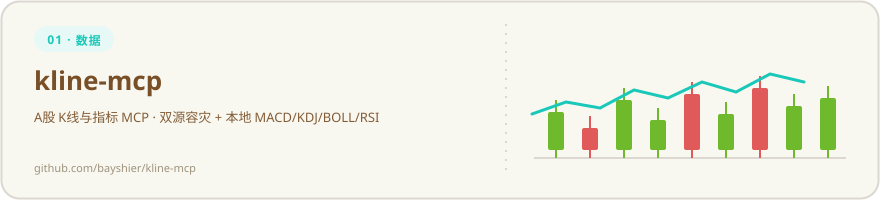
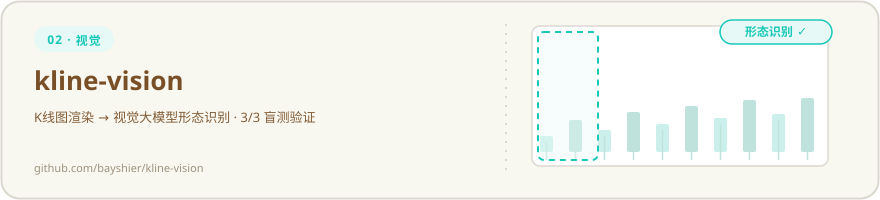
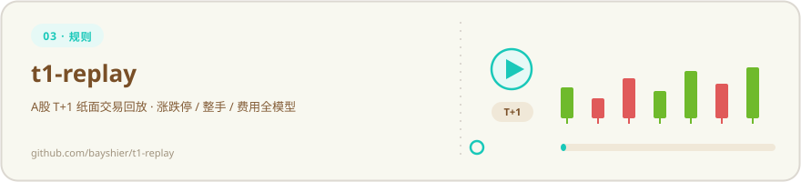
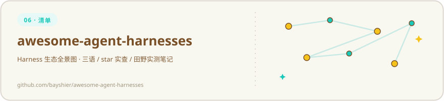
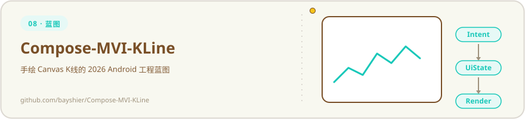

  <table>
    <tr>
      <td align="center" width="33%">
         
        <b>ChatGPT</b> 
        🏝️ 长期订阅 
        
      </td>
      <td align="center" width="33%">
         
        <b>Claude Code</b> 
        🏝️ 长期订阅 
        
      </td>
      <td align="center" width="33%">
         
        <b>Cursor</b> 
        🏝️ 长期订阅 
        
      </td>
    </tr>
  </table>

  

  

   

  
  
  

  <b>程序员，致力于分享有趣又有用的开源项目，希望每个人都能用 AI 得到更好的结果。</b> 
  <i>A programmer sharing fun &amp; useful open-source projects — so everyone can get better results with AI.</i>

### 🧺 开源矩阵 (Open Source Matrix)

AI Agent 工具链以 Kotlin 构建，每层独立可用——每个项目都配了动图；新展馆也住进了矩阵：

  

  

  

  

  

  

  

  

  

### 🗺️ 贡献轨迹 (Contribution Graph)

  <picture>
    <source media="(prefers-color-scheme: dark)" srcset="https://raw.githubusercontent.com/bayshier/bayshier/output/github-contribution-grid-snake-dark.svg">
    <source media="(prefers-color-scheme: light)" srcset="https://raw.githubusercontent.com/bayshier/bayshier/output/github-contribution-grid-snake.svg">
    
  </picture>

  

  <b>如果这些项目帮到了你，一颗 <a href="https://github.com/bayshier">star</a> 就是最大的鼓励，谢谢你来过 🌟</b> 
  <i>If any of these help you, a star means a lot. Thanks for stopping by.</i> 
  📮 Easinex@gmail.com

